<picture>
  <source media="(prefers-color-scheme: dark)" srcset="assets/terminal-dark.svg">
  
</picture>

```console
$ cat about.txt
后端开发，业余折腾 Docker、自托管和网络代理。

$ ls ~/orgs
z-docker-hub    # 自用 Docker 镜像与本地开发环境 → https://github.com/z-docker-hub
```
